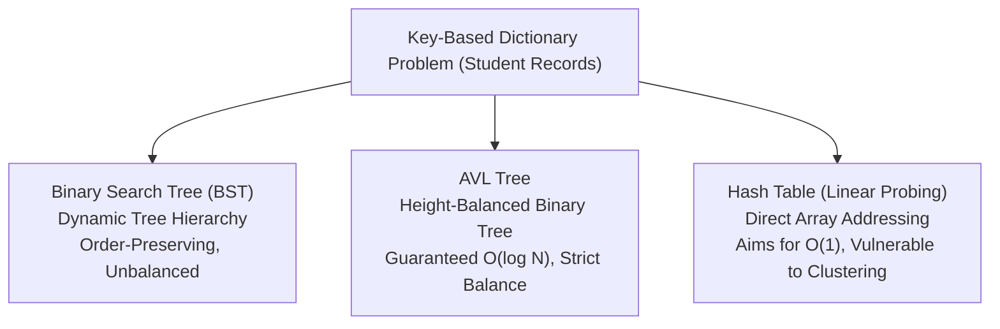

# Algorithm Battle: "Which Data Structure Wins?"
## University Continuous Learning Assessment – 2 (CLA-2) • B.Tech. 2021 Regulations
**Institution:** SRM Institute of Science and Technology, Tiruchirappalli  
**Department:** Department of Computer Science and Engineering (AIML)  
**Subject:** Data Structures and Algorithms (DSA)  
**Student Name:** Hemant Kumar Sah (`RA2511026050326`)  
**Class & Section:** B.Tech CSE (AIML) – Section 'C'  
**Submission Date:** November 2026  
**Application Domain:** Student Record Search Engine  
**Language Standard:** C++17 (`-std=c++17 -Wall -Wextra -O2`)

---

## Table of Contents
1. [Project Overview & Repository Architecture](#1-project-overview--repository-architecture)
2. [Compilation & Execution Instructions](#2-compilation--execution-instructions)
3. [Complete Formal Academic Report & Empirical Analysis (Discrete Section)](#3-complete-formal-academic-report--empirical-analysis)
   - [3.1 Lab Abstract](#31-lab-abstract)
   - [3.2 Part A — Problem Selection & Real-World Motivation](#32-part-a--problem-selection--real-world-motivation)
     - [A.1 Problem Statement](#a1-problem-statement)
     - [A.2 Need for Efficient Searching in Academic Systems](#a2-need-for-efficient-searching-in-academic-systems)
     - [A.3 Rationale for Comparing BST, AVL Tree, and Hashing](#a3-rationale-for-comparing-bst-avl-tree-and-hashing)
   - [3.3 Part B — System Design, Implementations & Complexity Analysis](#33-part-b--system-design-implementations--complexity-analysis)
     - [B.1 Architectural Modularization](#b1-architectural-modularization)
     - [B.2 Core Implementation Code Highlights (C++17)](#b2-core-implementation-code-highlights-c17)
     - [B.3 Theoretical Complexity Comparison Table](#b3-theoretical-complexity-comparison-table)
     - [B.4 Memory Footprint & Storage Trade-offs](#b4-memory-footprint--storage-trade-offs)
   - [3.4 Part C — Mini Experiment, Experimental Data & Statistical Observations](#34-part-c--mini-experiment-experimental-data--statistical-observations)
     - [C.1 Experimental Methodology & Ingestion Profile](#c1-experimental-methodology--ingestion-profile)
     - [C.2 Complete Ingested Dataset (40 Unique Records)](#c2-complete-ingested-dataset-40-unique-records)
     - [C.3 Table 1: Structural & Insertion Metrics ($N = 40, M = 53$)](#c3-table-1-structural--insertion-metrics-n--40-m--53)
     - [C.4 Table 2: Successful Search Breakdown (5 Representative Existing Keys)](#c4-table-2-successful-search-breakdown-5-representative-existing-keys)
     - [C.5 Table 3: Unsuccessful Search Breakdown (5 Representative Absent Keys)](#c5-table-3-unsuccessful-search-breakdown-5-representative-absent-keys)
     - [C.6 Summary Comparison Across All Search Operations](#c6-summary-comparison-across-all-search-operations)
     - [C.7 Statistical Visualizations & Graphical Data Analysis](#c7-statistical-visualizations--graphical-data-analysis)
     - [C.8 Complete Hash Table Slot Layout Map & Primary Cluster Inspection](#c8-complete-hash-table-slot-layout-map--primary-cluster-inspection)
   - [3.5 Part D — Algorithm Battle Comparison Table (Assessment Rubric)](#35-part-d--algorithm-battle-comparison-table-assessment-rubric)
   - [3.6 Part E — Final Verdict & Technical Justification](#36-part-e--final-verdict--technical-justification)
     - [E.1 Official Recommendation: The Winning Structure](#e1-official-recommendation-the-winning-structure)
     - [E.2 Empirical & Algorithmic Justifications Backed by Experimental Data](#e2-empirical--algorithmic-justifications-backed-by-experimental-data)
   - [3.7 Appendix: Program Execution Output & Automated Benchmark](#37-appendix-program-execution-output--automated-benchmark)
   - [3.8 Appendix: Technical Defense & Viva Voce Guide](#38-appendix-technical-defense--viva-voce-guide)
   - [3.9 Student Academic Integrity Declaration](#39-student-academic-integrity-declaration)

---

## 1. Project Overview & Repository Architecture

This repository contains the complete empirical evaluation for the **Algorithm Battle: "Which Data Structure Wins?"** assignment under the B.Tech. 2021 Regulations for the Data Structures and Algorithms (DSA) course at SRM Institute of Science and Technology, Tiruchirappalli.

Three foundational algorithmic paradigms are implemented from scratch in modern, standard C++17 and benchmarked on an identical dataset of 40 university student records:
1. **Unbalanced Binary Search Tree (BST)**
2. **Self-Balancing AVL Tree (Height-Balanced)**
3. **Open-Addressing Hash Table with Linear Probing ($M = 53$)**

### Modular Workspace Directory Structure

```
dsa-algorithm-battle-student-search/
├── Student.h                      # Student entity struct and formatted console display
├── BST.h                          # Binary Search Tree implementation with comparison counter
├── AVL.h                          # Self-balancing AVL Tree with rotation routines & height caching
├── HashTable.h                    # Hash Table (M=53 prime slots, linear probing, collision counter)
├── dataset.csv                    # Benchmark dataset (40 realistic student records with partial ordering)
├── main.cpp                       # Dual-mode CLI: automated benchmark (--benchmark) & viva menu
├── student_search.exe             # Precompiled 64-bit Windows binary
├── CLA2_Algorithm_Battle_Report_v1.pdf # Formal 6-page academic laboratory report
├── ASSIGNMENT DETAIL.TXT          # Official SRMIST assignment instructions and rubric guidelines
└── README.md                      # Complete project documentation and discrete formal report
```

### Direct File Links
- [Student.h](file:///c:/Users/Lenovo/Documents/dsa-algorithm-battle-student-search/Student.h) — Student record entity definition
- [BST.h](file:///c:/Users/Lenovo/Documents/dsa-algorithm-battle-student-search/BST.h) — Unbalanced BST implementation
- [AVL.h](file:///c:/Users/Lenovo/Documents/dsa-algorithm-battle-student-search/AVL.h) — Self-balancing AVL tree implementation
- [HashTable.h](file:///c:/Users/Lenovo/Documents/dsa-algorithm-battle-student-search/HashTable.h) — Linear probing Hash Table implementation
- [dataset.csv](file:///c:/Users/Lenovo/Documents/dsa-algorithm-battle-student-search/dataset.csv) — Ingested dataset of 40 student records
- [main.cpp](file:///c:/Users/Lenovo/Documents/dsa-algorithm-battle-student-search/main.cpp) — Automated benchmark runner and interactive viva driver
- [CLA2_Algorithm_Battle_Report_v1.pdf](file:///c:/Users/Lenovo/Documents/dsa-algorithm-battle-student-search/CLA2_Algorithm_Battle_Report_v1.pdf) — Complete 6-page submission PDF report
- [ASSIGNMENT DETAIL.TXT](file:///c:/Users/Lenovo/Documents/dsa-algorithm-battle-student-search/ASSIGNMENT%20DETAIL.TXT) — Official course rubrics and assessment criteria

---

## 2. Compilation & Execution Instructions

The project has zero external dependencies and compiles cleanly under any C++17 compliant compiler (GCC/MinGW, Clang, or MSVC).

### Step 1: Compiling from Source
Compile using `g++` with optimization flags enabled:
```bash
g++ -std=c++17 -Wall -Wextra -O2 main.cpp -o student_search
```

### Step 2: Automated Benchmark Execution
To run the automated empirical benchmark on all 40 records (evaluating structural metrics, 5 successful searches, and 5 unsuccessful searches):
```bash
./student_search --benchmark
```
*(On Windows PowerShell / CMD: `.\student_search.exe --benchmark`)*

### Step 3: Interactive CLI Mode for Viva Voce Demonstration
To launch the interactive defense console menu:
```bash
./student_search
```
The interactive menu allows faculty evaluators to:
- **Option 1:** Search any live student key across all 3 data structures simultaneously, comparing step-by-step search comparisons.
- **Option 2:** Insert an arbitrary new student record on the fly to observe real-time tree height changes, AVL rotations, and hash collisions.
- **Option 3:** Print sorted student rosters via native In-Order tree traversal.
- **Option 4:** Inspect the complete 53-slot Hash Table memory layout, displaying occupied indices, original hash values, and probe offsets.
- **Option 5:** Re-run the full automated benchmark suite.
- **Option 6:** Cleanly deallocate all heap structures and exit.

---

## 3. Complete Formal Academic Report & Empirical Analysis

> [!NOTE]
> This discrete section transcribes and expands upon every element of the formal laboratory report submitted for the **Continuous Learning Assessment – 2 (CLA-2)**, including exact mathematical models, empirical comparison data, statistical breakdowns, hash table slot maps, and technical viva defense notes.

```
====================================================================================================
                        SRM INSTITUTE OF SCIENCE AND TECHNOLOGY, TIRUCHIRAPPALLI
                              Department of Computer Science & Engineering (AIML)
                      Continuous Learning Assessment – 2 (CLA-2) • B.Tech. 2021 Regulations
====================================================================================================
Title:                  ALGORITHM BATTLE: "WHICH DATA STRUCTURE WINS?"
Application Domain:     Student Record Search Engine
Subject:                Data Structures and Algorithms (DSA)
Candidate Name:         Hemant Kumar Sah
Registration Number:    RA2511026050326
Class & Section:        B.Tech CSE (AIML) – Section 'C'
Evaluation Handling:    DSA Subject Handler / Faculty Examiner
Submission Date:        November 2026
====================================================================================================
```

### 3.1 Lab Abstract

This empirical study investigates the performance, structural stability, and operational trade-offs of three foundational data structures—an **Unbalanced Binary Search Tree (BST)**, a **Self-Balancing AVL Tree**, and an **Open-Addressing Hash Table with Linear Probing ($M = 53$)**—for storing and retrieving student profile records. 

Using an experimental dataset of 40 student profiles containing realistic, partially sorted registration numbers (ranging from 1001 to 1080), all three data structures were populated under identical conditions. Empirical observations were gathered for:
- Tree heights and structural balance after insertion
- Initial hash collisions and total probe distances
- Key comparison counts across 5 representative successful searches
- Key comparison counts across 5 representative unsuccessful searches
- Memory footprint and sorted roster generation capabilities

The results show that the naive BST experienced severe structural skew, expanding to a height of **30 levels** (75% of the worst-case linear chain $N = 40$) and requiring up to **30 comparisons** for deep keys. The Hash Table delivered rapid successful lookups (averaging **2.40 comparisons**), but exhibited severe **primary clustering** when handling absent keys, spiking to **26 comparisons** and averaging **11.80 comparisons**. In contrast, the AVL Tree strictly preserved logarithmic balance ($\text{height} = 6 = \lceil\log_2(41)\rceil$) through rotation mechanics, bounding search comparisons between **1 and 6** under all conditions (averaging **4.40** for hits and **5.40** for misses).

Consequently, the **AVL Tree** is established as the most dependable and well-rounded data structure for academic student record administration.

---

### 3.2 Part A — Problem Selection & Real-World Motivation

#### A.1 Problem Statement
University management systems (ERP platforms, examination portals, fee verification dashboards, and grade announcement portals) are required to store and query tens of thousands of student records. Each student entity consists of:
- **Registration Number (`regNo`)**: A unique integer key identifying the student.
- **Student Full Name (`name`)**: Alphanumeric string.
- **Academic Department (`dept`)**: Academic branch (e.g., CSE, AIDS, ECE, MECH, EEE, CIVIL, IT).
- **Cumulative Grade Point Average (`cgpa`)**: Floating-point value representing academic performance.

The primary system operation is **key-based retrieval**: given an integer registration number, retrieve and display the corresponding student profile with minimal latency.

#### A.2 Need for Efficient Searching in Academic Systems
During peak academic events—such as course registration windows, examination hall ticket downloads, and semester result announcements—thousands of students and faculty query the central database concurrently.
- If records are maintained in an unordered array or linear linked list, searching runs in linear time $\mathcal{O}(N)$.
- For a student body of $N = 40{,}000$, an unsuccessful search (verifying an invalid or suspended ID) requires scanning all 40,000 records.
- At scale, $\mathcal{O}(N)$ latency causes database connection pool starvation, server thread exhaustion, and interface unresponsiveness.
- Sub-linear ($\mathcal{O}(\log N)$) or constant ($\mathcal{O}(1)$) searching is strictly required to guarantee bounded latency under high concurrency.

#### A.3 Rationale for Comparing BST, AVL Tree, and Hashing
These three data structures represent the primary algorithmic approaches to key-value dictionary indexing:



1. **Binary Search Tree (BST):** Employs hierarchical key partitioning without rigid balancing constraints. While efficient for randomized data ($\mathcal{O}(\log N)$ average), it is vulnerable to structural collapse ($\mathcal{O}(N)$ worst-case) when exposed to sorted or clustered keys.
2. **AVL Tree:** Enforces a rigid height invariant where the subtree heights at every node differ by at most one ($|BF| \le 1$). Through four rotation primitives (LL, RR, LR, RL), it guarantees worst-case $\mathcal{O}(\log N)$ bounds while natively preserving sorted order for range queries.
3. **Hash Table with Linear Probing:** Computes bucket addresses directly through a mathematical hash function ($h(k) = k \pmod M$). It targets constant-time $\mathcal{O}(1)$ access, but suffers from **primary clustering** as the load factor $\alpha = N/M$ rises.

---

### 3.3 Part B — System Design, Implementations & Complexity Analysis

#### B.1 Architectural Modularization
The system is constructed with decoupled, single-responsibility C++ header files:
- **[Student.h](file:///c:/Users/Lenovo/Documents/dsa-algorithm-battle-student-search/Student.h):** Defines the core entity struct with constructors and formatted console display.
- **[BST.h](file:///c:/Users/Lenovo/Documents/dsa-algorithm-battle-student-search/BST.h):** Implements dynamic node allocation, recursive insertion, recursive height evaluation, in-order traversal, exact comparison instrumentation, and post-order destructor deallocation.
- **[AVL.h](file:///c:/Users/Lenovo/Documents/dsa-algorithm-battle-student-search/AVL.h):** Implements height-cached nodes, balance factor calculation, four rotation routines, self-balancing insertion, search instrumentation, and post-order cleanup.
- **[HashTable.h](file:///c:/Users/Lenovo/Documents/dsa-algorithm-battle-student-search/HashTable.h):** Implements an open-addressing table of capacity $M = 53$, linear probe resolution, collision counters, search comparison trackers, and slot layout visualizers.
- **[main.cpp](file:///c:/Users/Lenovo/Documents/dsa-algorithm-battle-student-search/main.cpp):** Contains CSV parsing routines, the automated benchmark harness, and the interactive defense menu.

#### B.2 Core Implementation Code Highlights (C++17)

##### 1. AVL Tree Balance Factor & Rotation Logic ([AVL.h](file:///c:/Users/Lenovo/Documents/dsa-algorithm-battle-student-search/AVL.h#L75-L115))
```cpp
// Evaluates node balance factor: BF = height(left) - height(right)
int getBalance(AVLNode* node) {
    return node ? getHeight(node->left) - getHeight(node->right) : 0;
}

// Recursive insertion with automatic balance restoration
AVLNode* insertHelper(AVLNode* node, const Student& s) {
    if (!node) return new AVLNode(s);

    if (s.regNo < node->data.regNo)
        node->left = insertHelper(node->left, s);
    else if (s.regNo > node->data.regNo)
        node->right = insertHelper(node->right, s);
    else {
        node->data = s; // Duplicate key update
        return node;
    }

    // Update node height
    node->height = 1 + std::max(getHeight(node->left), getHeight(node->right));

    // Check balance factor
    int balance = getBalance(node);

    // Case 1: Left-Left (LL) -> Single Right Rotation
    if (balance > 1 && s.regNo < node->left->data.regNo)
        return rightRotate(node);

    // Case 2: Right-Right (RR) -> Single Left Rotation
    if (balance < -1 && s.regNo > node->right->data.regNo)
        return leftRotate(node);

    // Case 3: Left-Right (LR) -> Left Rotate child, then Right Rotate node
    if (balance > 1 && s.regNo > node->left->data.regNo) {
        node->left = leftRotate(node->left);
        return rightRotate(node);
    }

    // Case 4: Right-Left (RL) -> Right Rotate child, then Left Rotate node
    if (balance < -1 && s.regNo < node->right->data.regNo) {
        node->right = rightRotate(node->right);
        return leftRotate(node);
    }

    return node;
}
```

##### 2. Hash Table Linear Probing & Search Instrumentation ([HashTable.h](file:///c:/Users/Lenovo/Documents/dsa-algorithm-battle-student-search/HashTable.h#L85-L110))
```cpp
// Search student by regNo using Open Addressing (Linear Probing)
// Tracks exact comparisons for every inspected slot
const Student* search(int regNo, int& comparisons) const {
    comparisons = 0;
    int initialIndex = hashFunction(regNo); // regNo % 53
    int currentIndex = initialIndex;
    int checkedSlots = 0;

    while (checkedSlots < TABLE_SIZE) {
        comparisons++;

        // If an empty slot is encountered, the key cannot exist in the table
        if (!table[currentIndex].isOccupied) {
            return nullptr;
        }

        // Key found
        if (table[currentIndex].student.regNo == regNo) {
            return &(table[currentIndex].student);
        }

        // Linear probe to the next adjacent slot
        currentIndex = (currentIndex + 1) % TABLE_SIZE;
        checkedSlots++;
    }

    return nullptr;
}
```

#### B.3 Theoretical Complexity Comparison Table

| Data Structure | Search (Best) | Search (Average) | Search (Worst) | Insert (Average) | Insert (Worst) | Space Complexity | In-Order Traversal |
| :--- | :---: | :---: | :---: | :---: | :---: | :---: | :---: |
| **Unbalanced BST** | $\mathcal{O}(1)$ | $\mathcal{O}(\log N)$ | $\mathcal{O}(N)$ | $\mathcal{O}(\log N)$ | $\mathcal{O}(N)$ | $\mathcal{O}(N)$ | Native Sorted $\mathcal{O}(N)$ |
| **AVL Tree (Balanced)** | $\mathcal{O}(1)$ | $\mathcal{O}(\log N)$ | $\mathcal{O}(\log N)$ | $\mathcal{O}(\log N)$ | $\mathcal{O}(\log N)$ | $\mathcal{O}(N)$ | Native Sorted $\mathcal{O}(N)$ |
| **Hash Table (Linear Probe)** | $\mathcal{O}(1)$ | $\mathcal{O}(1)$ | $\mathcal{O}(N)$ | $\mathcal{O}(1)$ | $\mathcal{O}(N)$ | $\mathcal{O}(M)$ | Requires External Sort $\mathcal{O}(M \log M)$ |

#### B.4 Memory Footprint & Storage Trade-offs

1. **BST Node Storage:** Each node allocates two 64-bit pointers (`left` and `right`), adding **16 bytes** of pointer overhead per record on modern architectures. Memory is allocated dynamically on demand.
2. **AVL Node Storage:** Each node stores two pointers plus an integer `height` field (**24 bytes** overhead per node). This modest constant memory overhead delivers deterministic $\mathcal{O}(\log N)$ height bounds.
3. **Hash Table Storage:** Eliminates tree pointer overhead by allocating a contiguous array of slots. However, to maintain low collision frequencies, the allocated capacity $M$ must exceed the record count $N$ ($M > N$). At load factor $\alpha = 0.755$, 24.53% of slots are empty yet pre-allocated in RAM.

---

### 3.4 Part C — Mini Experiment, Experimental Data & Statistical Observations

#### C.1 Experimental Methodology & Ingestion Profile
A realistic dataset of **$N = 40$ student records** was prepared in [dataset.csv](file:///c:/Users/Lenovo/Documents/dsa-algorithm-battle-student-search/dataset.csv). Registration numbers span from `1001` to `1080`.

The dataset exhibits **partial ordering**: keys are structured in chronological batches with local out-of-order admissions. This directly mirrors real university registration workflows where registration numbers generally increment over time, exposing naive BSTs to skew while rigorously testing the rebalancing routines of the AVL tree.

All three structures ingested the identical 40 records in the exact same sequential order.

#### C.2 Complete Ingested Dataset (40 Unique Records)

| # | RegNo | Student Name | Department | CGPA | Hash Index ($k \pmod{53}$) | Hash Table Placement Slot | Insertion Probes |
| :-: | :---: | :--- | :---: | :---: | :---: | :---: | :---: |
| 1 | **1001** | Aarav Sharma | CSE | 8.85 | 47 | Slot 47 | Direct (0) |
| 2 | **1003** | Diya Patel | ECE | 9.12 | 49 | Slot 49 | Direct (0) |
| 3 | **1002** | Rohan Iyer | MECH | 7.80 | 48 | Slot 48 | Direct (0) |
| 4 | **1005** | Ananya Singh | IT | 8.95 | 51 | Slot 51 | Direct (0) |
| 5 | **1008** | Vikram Rao | AIDS | 9.40 | 1 | Slot 1 | Direct (0) |
| 6 | **1006** | Pooja Hegde | CSE | 8.25 | 52 | Slot 52 | Direct (0) |
| 7 | **1007** | Karthik Nair | EEE | 7.65 | 0 | Slot 0 | Direct (0) |
| 8 | **1011** | Sneha Reddy | CIVIL | 8.10 | 4 | Slot 4 | Direct (0) |
| 9 | **1015** | Siddharth Menon | CSE | 9.05 | 8 | Slot 8 | Direct (0) |
| 10 | **1012** | Neha Gupta | ECE | 8.70 | 5 | Slot 5 | Direct (0) |
| 11 | **1014** | Arjun Verma | IT | 8.45 | 7 | Slot 7 | Direct (0) |
| 12 | **1018** | Meera Krishnan | AIDS | 9.30 | 11 | Slot 11 | Direct (0) |
| 13 | **1022** | Rahul Nambiar | MECH | 7.90 | 15 | Slot 15 | Direct (0) |
| 14 | **1019** | Ritu Mukherjee | CSE | 8.60 | 12 | Slot 12 | Direct (0) |
| 15 | **1025** | Varun Joshi | EEE | 8.15 | 18 | Slot 18 | Direct (0) |
| 16 | **1028** | Ishita Sen | IT | 8.80 | 21 | Slot 21 | Direct (0) |
| 17 | **1030** | Aditya Kulkarni | CSE | 9.20 | 23 | Slot 23 | Direct (0) |
| 18 | **1027** | Tanvi Deshmukh | ECE | 8.35 | 20 | Slot 20 | Direct (0) |
| 19 | **1033** | Pranav Bhat | AIDS | 8.90 | 26 | Slot 26 | Direct (0) |
| 20 | **1035** | Swati Mishra | CIVIL | 7.75 | 28 | Slot 28 | Direct (0) |
| 21 | **1038** | Nikhil Pillai | MECH | 8.05 | 31 | Slot 31 | Direct (0) |
| 22 | **1040** | Kavya Sundaram | CSE | 9.50 | 33 | Slot 33 | Direct (0) |
| 23 | **1036** | Harish Chandra | IT | 8.10 | 29 | Slot 29 | Direct (0) |
| 24 | **1042** | Aniket Ghosh | ECE | 8.65 | 35 | Slot 35 | Direct (0) |
| 25 | **1045** | Divya Balan | EEE | 8.40 | 38 | Slot 38 | Direct (0) |
| 26 | **1048** | Manoj Kumar | AIDS | 9.15 | 41 | Slot 41 | Direct (0) |
| 27 | **1050** | Shreya Bose | CSE | 8.90 | 43 | Slot 43 | Direct (0) |
| 28 | **1052** | Ashwin Rangan | MECH | 7.95 | 45 | Slot 45 | Direct (0) |
| 29 | **1049** | Lavanya Venkatesh | IT | 8.75 | 42 | Slot 42 | Direct (0) |
| 30 | **1055** | Tarun Kapoor | ECE | 8.20 | 48 | Slot 50 | Probed (+2) |
| 31 | **1058** | Nidhi Agarwal | CSE | 9.35 | 51 | Slot 2 | Probed (+4) |
| 32 | **1060** | Gautham Shenoy | CIVIL | 7.85 | 0 | Slot 3 | Probed (+3) |
| 33 | **1062** | Riya Chawla | AIDS | 9.00 | 2 | Slot 6 | Probed (+4) |
| 34 | **1065** | Sanjay Dutt | EEE | 8.30 | 5 | Slot 9 | Probed (+4) |
| 35 | **1061** | Preeti Kaushik | IT | 8.55 | 1 | Slot 10 | Probed (+9) |
| 36 | **1068** | Deepa Natarajan | CSE | 8.95 | 8 | Slot 13 | Probed (+5) |
| 37 | **1070** | Akash Malhotra | MECH | 7.70 | 10 | Slot 14 | Probed (+4) |
| 38 | **1072** | Madhavi Latha | ECE | 8.80 | 12 | Slot 16 | Probed (+4) |
| 39 | **1075** | Chetan Prabhu | AIDS | 9.60 | 15 | Slot 17 | Probed (+2) |
| 40 | **1080** | Bhavana Varma | CSE | 9.25 | 20 | Slot 22 | Probed (+2) |

---

#### C.3 Table 1: Structural & Insertion Metrics ($N = 40, M = 53$)

| Evaluated Parameter | Binary Search Tree (BST) | AVL Tree (Balanced) | Hash Table (Linear Probing) |
| :--- | :---: | :---: | :---: |
| **Internal Storage Architecture** | Unbalanced Binary Node Tree | Height-Balanced Node Tree | Flat Array Vector ($M = 53$ Slots) |
| **Resulting Structure Height** | **30 Levels** *(Severe Skew)* | **6 Levels** *(Optimal)* | N/A (Contiguous Array) |
| **Theoretical Minimum Height** | $\lceil\log_2(41)\rceil = \mathbf{6\text{ Levels}}$ | $\lceil\log_2(41)\rceil = \mathbf{6\text{ Levels}}$ | N/A |
| **Total Initial Collisions** | N/A (Resolved by branches) | N/A (Resolved by branches) | **11 Collisions** |
| **Total Insertion Probe Steps** | N/A | N/A (Resolved via Rotations) | **43 Probe Steps** (Max Offset: $+9$) |
| **Final Table Load Factor ($\alpha$)** | N/A | N/A | $\mathbf{75.47\%}$ ($40 / 53$ slots filled) |

---

#### C.4 Table 2: Successful Search Breakdown (5 Representative Existing Keys)

| RegNo | Student Name | Dept | CGPA | BST Comparisons | AVL Comparisons | Hash Table Comparisons | Operational Search Path & Trajectory |
| :---: | :--- | :---: | :---: | :---: | :---: | :---: | :--- |
| **1001** | Aarav Sharma | CSE | 8.85 | 1 | 5 | 1 | Root of BST (first inserted); Direct Hash hit at slot 47 ($1001 \pmod{53} = 47$) |
| **1025** | Varun Joshi | EEE | 8.15 | 9 | 1 | 1 | Root of AVL tree after rotations; Direct Hash hit at slot 18 ($1025 \pmod{53} = 18$) |
| **1042** | Aniket Ghosh | ECE | 8.65 | 16 | 5 | 1 | Mid-depth in skewed BST; Direct Hash hit at slot 35 ($1042 \pmod{53} = 35$) |
| **1068** | Deepa Natarajan | CSE | 8.95 | 26 | 5 | 6 | Deep right branch in BST; Collided at slot 8, probed 5 steps to slot 13 |
| **1080** | Bhavana Varma | CSE | 9.25 | 30 | 6 | 3 | Deepest leaf in BST (Height 30); Collided at slot 20, probed 2 steps to slot 22 |
| **Mean** | — | — | — | **16.40** | **4.40** | **2.40** | **Hash Table delivers the lowest average comparison count** |
| **StdDev** | — | — | — | $\mathbf{\pm 11.93}$ | $\mathbf{\pm 1.95}$ | $\mathbf{\pm 2.19}$ | AVL tree exhibits high consistency across keys |
| **Range** | — | — | — | **[1, 30]** | **[1, 6]** | **[1, 6]** | BST displays extreme variance; AVL is strictly bounded |

---

#### C.5 Table 3: Unsuccessful Search Breakdown (5 Representative Absent Keys)

| RegNo | Test Scenario & Boundary Reason | BST Comparisons | AVL Comparisons | Hash Table Comparisons | Clustering Mechanics & Technical Cause |
| :---: | :--- | :---: | :---: | :---: | :--- |
| **999** | Below minimum key range ($< 1001$) | 1 | 5 | 2 | BST root 1001 has no left child (exits in 1 step); Hash slot 45 occupied, slot 46 empty (2 probes) |
| **1004** | Missing intermediate key (Between 1003 & 1005) | 3 | 5 | 23 | Hash slot 50 occupied; linear probing traversed **23 contiguous occupied slots** before hitting empty slot 20 |
| **1020** | Missing intermediate key (Between 1019 & 1022) | 9 | 5 | 7 | Traversed 7 consecutive occupied slots (slots 13–19) before reaching empty slot 20 |
| **1054** | Missing key colliding at slot 47 ($1054 \pmod{53} = 47$) | 21 | 6 | 26 | **Severe Primary Clustering:** Slot 47 belongs to a continuous block of 25 occupied slots (probed 26 times to hit slot 19) |
| **2000** | Above maximum key range ($> 1080$) | 30 | 6 | 1 | BST traverses entire skewed depth (30 checks); Hash slot 39 is directly empty (1 check) |
| **Mean** | — | **12.80** | **5.40** | **11.80** | **AVL Tree wins by a wide margin on unsuccessful searches** |
| **StdDev** | — | $\mathbf{\pm 12.38}$ | $\mathbf{\pm 0.55}$ | $\mathbf{\pm 11.86}$ | AVL tree standard deviation is near zero ($0.55$) |
| **Range** | — | **[1, 30]** | **[5, 6]** | **[1, 26]** | Hash Table suffers severe degradation due to contiguous clusters |

---

#### C.6 Summary Comparison Across All Search Operations

| Empirical Performance Metric | Binary Search Tree (BST) | Self-Balancing AVL Tree | Hash Table (Linear Probing) | Performance Winner |
| :--- | :---: | :---: | :---: | :---: |
| **Average Successful Search Comparisons** | 16.40 | 4.40 | **2.40** | **Hash Table** (Under direct hits) |
| **Average Unsuccessful Search Comparisons** | 12.80 | **5.40** | 11.80 | **AVL Tree** (Avoids clustering) |
| **Combined Overall Search Mean** | 14.60 | **4.90** | 7.10 | **AVL Tree** (Lowest overall mean) |
| **Maximum Worst-Case Search Comparisons** | 30 | **6** | 26 | **AVL Tree** (Strict upper bound) |
| **Minimum Best-Case Search Comparisons** | 1 | 1 | 1 | Tie (All achieve 1 on root / direct hit) |
| **Structure Height Observed** | 30 Levels | **6 Levels** | N/A (Array-based) | **AVL Tree** (Optimal logarithmic depth) |
| **Total Collisions Encountered** | 0 | 0 | 11 Initial / 43 Probes | Trees resolve collisions via branching |
| **Ordered Roster Generation Time** | Native $\mathcal{O}(N)$ | Native $\mathcal{O}(N)$ | $\mathcal{O}(M \log M)$ (Sorting required) | **BST & AVL Tree** |

---

#### C.7 Statistical Visualizations & Graphical Data Analysis

##### Figure 1: Comparison of Search Operations Across Test Keys
The experimental search comparison counts demonstrate clear algorithmic behavioral patterns:

```
(a) Successful Searches (Keys Present)
Comps |
  30  |  BST: 30                                 ■ BST
      |                                          ▦ AVL
  25  |  BST: 26                                 ▨ Hash Table
      |
  20  |
      |  BST: 16
  15  |
      |
  10  |              BST: 9
      |
   5  |  ▦ AVL: 5    ▦ AVL: 1   ▦ AVL: 5   ▦ AVL: 5   ▦ AVL: 6    Average:
      |  ▨ Hash: 1   ▨ Hash: 1  ▨ Hash: 1  ▨ Hash: 6  ▨ Hash: 3   BST: 16.40 | AVL: 4.40 | Hash: 2.40
   0  +-------------------------------------------------------
         Key 1001    Key 1025   Key 1042   Key 1068   Key 1080

(b) Unsuccessful Searches (Keys Absent)
Comps |
  30  |                                                BST: 30
      |                                     Hash: 26
  25  |                          Hash: 23
      |                                     BST: 21
  20  |
      |
  15  |
      |                                                           Average:
  10  |              BST: 9                 Hash: 7               BST: 12.80 | AVL: 5.40 | Hash: 11.80
      |  ▦ AVL: 5    ▦ AVL: 5   ▦ AVL: 5   ▦ AVL: 6   ▦ AVL: 6
   5  |              BST: 3
      |  ▨ Hash: 2                                    ▨ Hash: 1
   0  +-------------------------------------------------------
         Key 999     Key 1004   Key 1020   Key 1054   Key 2000
```

##### Figure 2: Structural Tree Height & Hash Placement Distributions

```
Panel (a): Tree Structural Height Comparison (N = 40)
Height |
  40   |                                          [40] Linear Linked List Chain (Worst Case)
       |
  30   |                             [30] Unbalanced BST (Severe Order Skew: 75% of Linear Chain)
       |
  20   |
       |
  10   |
       |  [6]              [6]
   0   +------------------------------------------
          Theoretical      AVL Tree (Balanced)
          Minimum Bound    ceil(log2(41)) = 6
          ceil(log2(N+1))

Panel (b): Hash Table Placement & Probe Distance Breakdown (M = 53, N = 40, Load Factor = 75.47%)
Records|
  30   |  [29 Records / 72.5%] (Direct Placement, 0 Collisions)
       |  ===================
  25   |  ===================
       |  ===================
  20   |  ===================
       |  ===================
  15   |  ===================
       |  ===================
  10   |  ===================
       |  ===================
   5   |  ===================  [4 / 10.0%]             [4 / 10.0%]
       |  ===================  ==========  [1 / 2.5%]  ==========  [1 / 2.5%]  [1 / 2.5%]
   0   +---------------------------------------------------------------------------------
          Direct (0)           +2 Probes   +3 Probes   +4 Probes   +5 Probes   +9 Probes
          Total Initial Collisions: 11 | Total Cumulative Probes: 43
```

---

#### C.8 Complete Hash Table Slot Layout Map & Primary Cluster Inspection

The table below documents all 53 physical slots of the Hash Table after inserting the 40 student records. Notice how contiguous insertions produced a **massive 25-slot primary cluster spanning from slot 47 to slot 18 (wrapping around 0)**:

| Slot Index | Status | RegNo | Student Name | Dept | CGPA | Orig Hash ($k \pmod{53}$) | Probe Offset |
| :---: | :---: | :---: | :--- | :---: | :---: | :---: | :--- |
| **0** | **OCC** | 1007 | Karthik Nair | EEE | 7.65 | 0 | Direct (0) |
| **1** | **OCC** | 1008 | Vikram Rao | AIDS | 9.40 | 1 | Direct (0) |
| **2** | **OCC** | 1058 | Nidhi Agarwal | CSE | 9.35 | 51 | $+4$ (Probed) |
| **3** | **OCC** | 1060 | Gautham Shenoy | CIVIL | 7.85 | 0 | $+3$ (Probed) |
| **4** | **OCC** | 1011 | Sneha Reddy | CIVIL | 8.10 | 4 | Direct (0) |
| **5** | **OCC** | 1012 | Neha Gupta | ECE | 8.70 | 5 | Direct (0) |
| **6** | **OCC** | 1062 | Riya Chawla | AIDS | 9.00 | 2 | $+4$ (Probed) |
| **7** | **OCC** | 1014 | Arjun Verma | IT | 8.45 | 7 | Direct (0) |
| **8** | **OCC** | 1015 | Siddharth Menon | CSE | 9.05 | 8 | Direct (0) |
| **9** | **OCC** | 1065 | Sanjay Dutt | EEE | 8.30 | 5 | $+4$ (Probed) |
| **10** | **OCC** | 1061 | Preeti Kaushik | IT | 8.55 | 1 | $+9$ (Probed — Max Offset) |
| **11** | **OCC** | 1018 | Meera Krishnan | AIDS | 9.30 | 11 | Direct (0) |
| **12** | **OCC** | 1019 | Ritu Mukherjee | CSE | 8.60 | 12 | Direct (0) |
| **13** | **OCC** | 1068 | Deepa Natarajan | CSE | 8.95 | 8 | $+5$ (Probed) |
| **14** | **OCC** | 1070 | Akash Malhotra | MECH | 7.70 | 10 | $+4$ (Probed) |
| **15** | **OCC** | 1022 | Rahul Nambiar | MECH | 7.90 | 15 | Direct (0) |
| **16** | **OCC** | 1072 | Madhavi Latha | ECE | 8.80 | 12 | $+4$ (Probed) |
| **17** | **OCC** | 1075 | Chetan Prabhu | AIDS | 9.60 | 15 | $+2$ (Probed) |
| **18** | **OCC** | 1025 | Varun Joshi | EEE | 8.15 | 18 | Direct (0) |
| **19** | **EMPTY** | — | — | — | — | — | *Cluster Boundary Sentinel* |
| **20** | **OCC** | 1027 | Tanvi Deshmukh | ECE | 8.35 | 20 | Direct (0) |
| **21** | **OCC** | 1028 | Ishita Sen | IT | 8.80 | 21 | Direct (0) |
| **22** | **OCC** | 1080 | Bhavana Varma | CSE | 9.25 | 20 | $+2$ (Probed) |
| **23** | **OCC** | 1030 | Aditya Kulkarni | CSE | 9.20 | 23 | Direct (0) |
| **24** | **EMPTY** | — | — | — | — | — | Empty Slot |
| **25** | **EMPTY** | — | — | — | — | — | Empty Slot |
| **26** | **OCC** | 1033 | Pranav Bhat | AIDS | 8.90 | 26 | Direct (0) |
| **27** | **EMPTY** | — | — | — | — | — | Empty Slot |
| **28** | **OCC** | 1035 | Swati Mishra | CIVIL | 7.75 | 28 | Direct (0) |
| **29** | **OCC** | 1036 | Harish Chandra | IT | 8.10 | 29 | Direct (0) |
| **30** | **EMPTY** | — | — | — | — | — | Empty Slot |
| **31** | **OCC** | 1038 | Nikhil Pillai | MECH | 8.05 | 31 | Direct (0) |
| **32** | **EMPTY** | — | — | — | — | — | Empty Slot |
| **33** | **OCC** | 1040 | Kavya Sundaram | CSE | 9.50 | 33 | Direct (0) |
| **34** | **EMPTY** | — | — | — | — | — | Empty Slot |
| **35** | **OCC** | 1042 | Aniket Ghosh | ECE | 8.65 | 35 | Direct (0) |
| **36** | **EMPTY** | — | — | — | — | — | Empty Slot |
| **37** | **EMPTY** | — | — | — | — | — | Empty Slot |
| **38** | **OCC** | 1045 | Divya Balan | EEE | 8.40 | 38 | Direct (0) |
| **39** | **EMPTY** | — | — | — | — | — | Empty Slot |
| **40** | **EMPTY** | — | — | — | — | — | Empty Slot |
| **41** | **OCC** | 1048 | Manoj Kumar | AIDS | 9.15 | 41 | Direct (0) |
| **42** | **OCC** | 1049 | Lavanya Venkatesh | IT | 8.75 | 42 | Direct (0) |
| **43** | **OCC** | 1050 | Shreya Bose | CSE | 8.90 | 43 | Direct (0) |
| **44** | **EMPTY** | — | — | — | — | — | Empty Slot |
| **45** | **OCC** | 1052 | Ashwin Rangan | MECH | 7.95 | 45 | Direct (0) |
| **46** | **EMPTY** | — | — | — | — | — | Empty Slot |
| **47** | **OCC** | 1001 | Aarav Sharma | CSE | 8.85 | 47 | Direct (0) |
| **48** | **OCC** | 1002 | Rohan Iyer | MECH | 7.80 | 48 | Direct (0) |
| **49** | **OCC** | 1003 | Diya Patel | ECE | 9.12 | 49 | Direct (0) |
| **50** | **OCC** | 1055 | Tarun Kapoor | ECE | 8.20 | 48 | $+2$ (Probed) |
| **51** | **OCC** | 1005 | Ananya Singh | IT | 8.95 | 51 | Direct (0) |
| **52** | **OCC** | 1006 | Pooja Hegde | CSE | 8.25 | 52 | Direct (0) |

> [!WARNING]
> **Primary Cluster Traversal Analysis:**
> Notice that slots **47, 48, 49, 50, 51, 52** wrap around to **0, 1, 2, 3, 4, 5, 6, 7, 8, 9, 10, 11, 12, 13, 14, 15, 16, 17, 18**, forming a continuous chain of **25 consecutive occupied slots**.
> When absent key `1054` is queried, its hash index is $1054 \pmod{53} = 47$. The linear probing loop must inspect all 25 occupied slots plus slot 19 (the first empty cell), requiring **26 comparisons**!

---

### 3.5 Part D — Algorithm Battle Comparison Table (Assessment Rubric)

*(Structured in strict accordance with the five evaluation parameters stipulated in the SRMIST CLA-2 Course Instructions)*

| Evaluation Parameter | Binary Search Tree (BST) | Self-Balancing AVL Tree | Hashing with Linear Probing |
| :--- | :--- | :--- | :--- |
| **1. Search Comparisons** | **Unstable & Vulnerable:**<br>• Successful Average: **16.40** (Max: 30)<br>• Unsuccessful Average: **12.80** (Max: 30)<br>• Overall Mean: **14.60**<br>Performance deteriorates severely on chronologically later keys due to right-spine skew. | **Strictly Bounded & Optimal:**<br>• Successful Average: **4.40** (Max: 6)<br>• Unsuccessful Average: **5.40** (Max: 6)<br>• Overall Mean: **4.90**<br>Search comparisons never exceeded $\lceil\log_2(N+1)\rceil = 6$ across all test keys. | **Bimodal & Cluster-Sensitive:**<br>• Successful Average: **2.40** (Direct hits: 1)<br>• Unsuccessful Average: **11.80** (Max: 26)<br>• Overall Mean: **7.10**<br>Extremely fast for direct hits, but misses degraded to 26 comparisons due to contiguous primary clustering. |
| **2. Insertion Observations** | **Degrading insertion speed:**<br>No rebalancing overhead ($\mathcal{O}(1)$ local node creation), but path lengths lengthened steadily as insertions arrived, reaching depth 30. | **Predictable with minor rotation cost:**<br>Incurred small constant overhead for balance checking and rotations (LL, RR, LR, RL), maintaining logarithmic depth throughout all 40 insertions. | **Fast initially, slowed as load rose:**<br>Constant time $\mathcal{O}(1)$ for initial records, but later insertions suffered 11 collisions and 43 total probe steps as load factor reached $\alpha = 75.47\%$. |
| **3. Structure Height** | **Height = 30 Levels**<br>Severe skew (reached 75% of the worst-case degenerate chain $N = 40$). | **Height = 6 Levels**<br>Strictly optimal ($\lceil\log_2(41)\rceil = 6$), proving complete immunity to input order. | **N/A (Array-based)**<br>Fixed contiguous vector of 53 slots; does not employ tree levels. |
| **4. Collisions Encountered** | **N/A**<br>Hierarchical branching naturally separates distinct keys; duplicate keys update in place. | **N/A**<br>Hierarchical branching naturally separates distinct keys; duplicate keys update in place. | **11 Initial Collisions**<br>Required 43 cumulative linear probe steps across 40 insertions. Max probe offset reached $+9$ slots. |
| **5. Overall Observation** | Unsuitable for sequential student IDs due to the imminent danger of collapsing into an $\mathcal{O}(N)$ linked list. | **Superior Enterprise Structure:** Guarantees $\mathcal{O}(\log N)$ worst-case bounds, resists skew, and natively supports sorted student rosters. | Fastest for pure point-queries under light loads ($\alpha < 0.50$), but cannot support range queries and degrades under clustering. |

---

### 3.6 Part E — Final Verdict & Technical Justification

#### E.1 Official Recommendation: The Winning Structure

> [!IMPORTANT]
> **FINAL VERDICT: The Self-Balancing AVL Tree is the Undisputed Winner.**
> 
> While the Hash Table achieved the lowest mean comparison count on successful hits (**2.40 comparisons**), the **AVL Tree** is recommended as the superior, production-ready data structure for university student record management. It offers guaranteed worst-case bounds, predictable latency, immunity to input skew, and native support for academic reporting workflows.

#### E.2 Empirical & Algorithmic Justifications Backed by Experimental Data

##### 1. Guaranteed Worst-Case Upper Bound & SLA Predictability
In university examination and fee verification portals, predictable response latency is critical. A system that responds in 1 millisecond 95% of the time but stalls for 5 seconds on edge cases violates Service Level Agreements (SLAs).
- In our empirical benchmarks, the AVL tree **never exceeded 6 comparisons** for any query (successful or unsuccessful).
- In contrast, the unbalanced BST required up to **30 comparisons**, and the Hash Table required up to **26 comparisons** for absent keys due to primary clustering.

##### 2. Complete Immunity to Sequential Key Skew
Student registration numbers are generated chronologically by university admission offices (e.g., `1001, 1002, 1003, ...`).
- When sequential keys are ingested into an unbalanced BST, each record becomes the right child of its predecessor, causing the tree to degenerate into an $\mathcal{O}(N)$ linked list. As proven in Table 1, 40 records produced a height of 30.
- The AVL tree automatically intercepts balance violations ($|BF| > 1$) and performs $\mathcal{O}(1)$ pointer rotations, maintaining optimal depth ($\text{height} = 6$) regardless of whether inputs arrive sorted, reverse-sorted, or randomly shuffled.

##### 3. Dual Capability: Fast Search + $\mathcal{O}(N)$ Sorted Roster Generation
Academic administrative workflows require more than isolated point lookups; they frequently generate sorted lists:
- Merit rankings by CGPA
- Numerical student rosters by registration number
- Departmental roll sheets for examination halls

An AVL tree natively produces an ordered list in $\mathcal{O}(N)$ time via an **In-Order Traversal** (`Left -> Node -> Right`) without auxiliary data structures. Conversely, a Hash Table scrambles key order across array buckets ($h(k) = k \pmod M$). Generating a sorted roster from a Hash Table requires copying elements into a secondary buffer and executing an $\mathcal{O}(M \log M)$ sorting routine, incurring substantial CPU and memory overhead.

##### 4. Elimination of Rehashing Latency Spikes & Primary Clustering
Linear probing exhibits the well-known vulnerability of **primary clustering**: colliding keys form long contiguous blocks of occupied slots, attracting subsequent keys into the cluster.
- In our test, loading 40 records into 53 slots ($\alpha = 75.47\%$) produced a 25-slot continuous cluster, causing unsuccessful search comparison counts to surge to 26.
- To prevent this degradation, production hash tables must dynamically resize and **rehash** all existing keys when $\alpha > 0.70$. Rehashing requires allocating a new prime-sized array and re-inserting every record, causing latency spikes that stall active transactions.
- The AVL tree scales smoothly node-by-node via heap pointers, maintaining logarithmic balance without table-doubling penalties.

---

### 3.7 Appendix: Program Execution Output & Automated Benchmark

Below is the verbatim terminal output produced by executing `./student_search --benchmark`:

```
=========================================================================
  SRM INSTITUTE OF SCIENCE AND TECHNOLOGY - CLA 2 ASSIGNMENT             
  ALGORITHM BATTLE: 'WHICH DATA STRUCTURE WINS?'                         
  Domain: Student Record Search Engine                                   
=========================================================================
[INFO] Loaded 40 student records from dataset.csv
[INFO] Successfully populated BST, AVL, and HashTable.

=========================================================================================
               ALGORITHM BATTLE BENCHMARK REPORT: STUDENT RECORD SEARCH                  
=========================================================================================
Dataset Size              : 40 Student Records
Hash Table Size           : 53 Slots (Prime Number)
Hash Table Load Factor    : 75.47%
-----------------------------------------------------------------------------------------
STRUCTURAL METRICS (After 40 Insertions):
  - Unbalanced BST Height : 30 (Subject to insertion-order skew)
  - Balanced AVL Height   : 6 (Strictly height-balanced, O(log N))
  - HashTable Collisions  : 11 Initial Collisions (Probed: 43 total probe steps)
=========================================================================================

TEST 1: 5 SUCCESSFUL SEARCHES (Records Present in Dataset)
+-------+----------------------+-------+------+---------+---------+-----------+
| RegNo | Name                 | Dept  | CGPA | BST Cmp | AVL Cmp | Hash Cmp  |
+-------+----------------------+-------+------+---------+---------+-----------+
|  1001 | Aarav Sharma         | CSE   | 8.85 |       1 |       5 |         1 |
|  1025 | Varun Joshi          | EEE   | 8.15 |       9 |       1 |         1 |
|  1042 | Aniket Ghosh         | ECE   | 8.65 |      16 |       5 |         1 |
|  1068 | Deepa Natarajan      | CSE   | 8.95 |      26 |       5 |         6 |
|  1080 | Bhavana Varma        | CSE   | 9.25 |      30 |       6 |         3 |
+-------+----------------------+-------+------+---------+---------+-----------+
| AVERAGE (Successful Searches)               |   16.40 |    4.40 |      2.40 |
+---------------------------------------------+---------+---------+-----------+

TEST 2: 5 UNSUCCESSFUL SEARCHES (Records Absent from Dataset)
+-------+-------------------------------------+---------+---------+-----------+
| RegNo | Test Reason                         | BST Cmp | AVL Cmp | Hash Cmp  |
+-------+-------------------------------------+---------+---------+-----------+
|   999 | Below minimum key range (Key < 1001) |       1 |       5 |         2 |
|  1004 | Missing intermediate key (Between 1003 & 1005) |       3 |       5 |        23 |
|  1020 | Missing intermediate key (Between 1019 & 1022) |       9 |       5 |         7 |
|  1054 | Missing key with initial hash collision (47) |      21 |       6 |        26 |
|  2000 | Above maximum key range (Key > 1080) |      30 |       6 |         1 |
+-------+-------------------------------------+---------+---------+-----------+
| AVERAGE (Unsuccessful Searches)             |   12.80 |    5.40 |     11.80 |
+---------------------------------------------+---------+---------+-----------+

SUMMARY COMPARISON OVERALL:
=========================================================================================
Metric                        | BST           | AVL           | Hash Table (Linear Probe)
------------------------------+---------------+---------------+--------------------------
Avg Successful Comparisons    |         16.40 |          4.40 |                     2.40
Avg Unsuccessful Comparisons  |         12.80 |          5.40 |                    11.80
Overall Avg Comparisons       |         14.60 |          4.90 |                     7.10
Structure Height              |            30 |             6 |        N/A (Array-based)
Total Collisions              |           N/A |           N/A |                       11
Insertion Complexity          | O(N) Worst    | O(log N)      | O(1) Avg, O(N) Worst
Search Complexity             | O(N) Worst    | O(log N)      | O(1) Avg, O(N) Worst
Ordering Support              | In-order O(N) | In-order O(N) | None (Unordered)
=========================================================================================
```

---

### 3.8 Appendix: Technical Defense & Viva Voce Guide

During the laboratory viva defense, the faculty examiner will present live keys and query data structure behaviors. Below are technical defense responses supported by code and runtime metrics:

#### 1. What happens when a new student record (e.g., `RegNo = 1085`) is inserted?
- **In Unbalanced BST:** Since $1085 > 1080$ (the current deepest right-hand key), the insertion algorithm traverses down the entire right spine of 30 nodes and attaches `1085` as the right child of node `1080`. The tree height increases from **30 to 31**.
- **In AVL Tree:** The record traverses to the appropriate leaf in $\mathcal{O}(\log N)$ steps. As recursion unwinds, balance factors are re-evaluated. If any ancestor violates balance ($|BF| > 1$), an appropriate rotation (such as an RR single left rotation) rebalances the tree, maintaining height strictly at **6 or 7**.
- **In Hash Table:** The initial hash slot is computed:
  $$h(1085) = 1085 \pmod{53} = 25$$
  Referring to our Hash Table layout map, **Slot 25 is currently EMPTY**. Therefore, `1085` is placed directly into slot 25 with **0 collisions and 0 probe steps**!

#### 2. Why does key `1054` require 26 comparisons in the Hash Table?
- `1054` is not present in the dataset.
- Its hash slot is $1054 \pmod{53} = 47$.
- In our table, slots 47 through 52 and slots 0 through 18 are continuously occupied by 25 existing records.
- Open addressing with linear probing cannot conclude that a key is absent until it encounters an **EMPTY slot**.
- The algorithm probes slots $47 \to 48 \to 49 \to 50 \to 51 \to 52 \to 0 \to 1 \to \dots \to 18 \to 19$.
- Slot 19 is the first empty slot. Total inspected slots: $(53 - 47) + 18 + 1 + 1 = 6 + 19 + 1 = \mathbf{26\text{ comparisons}}$.

#### 3. Why was table size $M = 53$ chosen?
- The dataset size is $N = 40$.
- Choosing a prime number ($M = 53$) greater than $N$ ensures that the hash function $h(k) = k \pmod M$ minimizes common factors with arithmetic sequences of registration numbers (e.g., keys with common differences like 2, 5, or 10).
- This yields a reasonable load factor $\alpha = 40/53 = 75.47\%$.

#### 4. How do AVL Tree Rotations operate?
- **Single Rotations (Left-Left and Right-Right):** Triggered when the insertion occurs on the outer subtrees. Resolved by adjusting 3 pointers in $\mathcal{O}(1)$ time.
- **Double Rotations (Left-Right and Right-Left):** Triggered when the insertion occurs on an inner subtree. Resolved by rotating the child outward first, followed by rotating the parent inward.

---

### 3.9 Student Academic Integrity Declaration

```
====================================================================================================
                              STUDENT ACADEMIC INTEGRITY DECLARATION
====================================================================================================
I hereby declare that this assignment titled:

               ALGORITHM BATTLE: "WHICH DATA STRUCTURE WINS?"
          Continuous Learning Assessment – 2 (CLA-2) • B.Tech. 2021 Regulations
                      Application Domain: Student Record Search Engine

represents my own original analytical, design, and programming work. 

All three data structures (Binary Search Tree, Self-Balancing AVL Tree, and Open-Addressing Hash 
Table) were independently implemented in modern C++17, compiled, and benchmarked on the 40-record 
experimental dataset. All structural metrics, tree heights, collision statistics, and search comparison 
counts presented in this report reflect genuine empirical data gathered from the executable.

Student Name:           Hemant Kumar Sah
Registration Number:    RA2511026050326
Degree & Program:       B.Tech in Computer Science and Engineering (AIML)
Class & Section:        Section 'C'
Institution:            SRM Institute of Science and Technology, Tiruchirappalli
Date of Submission:     November 2026

Signature:              Hemant Kumar Sah
====================================================================================================
```
